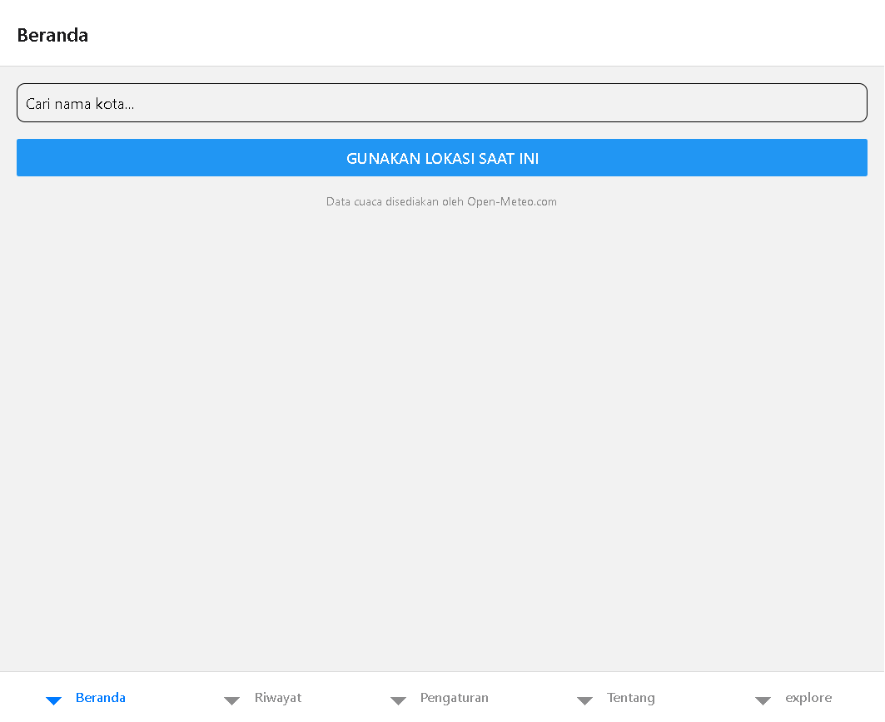
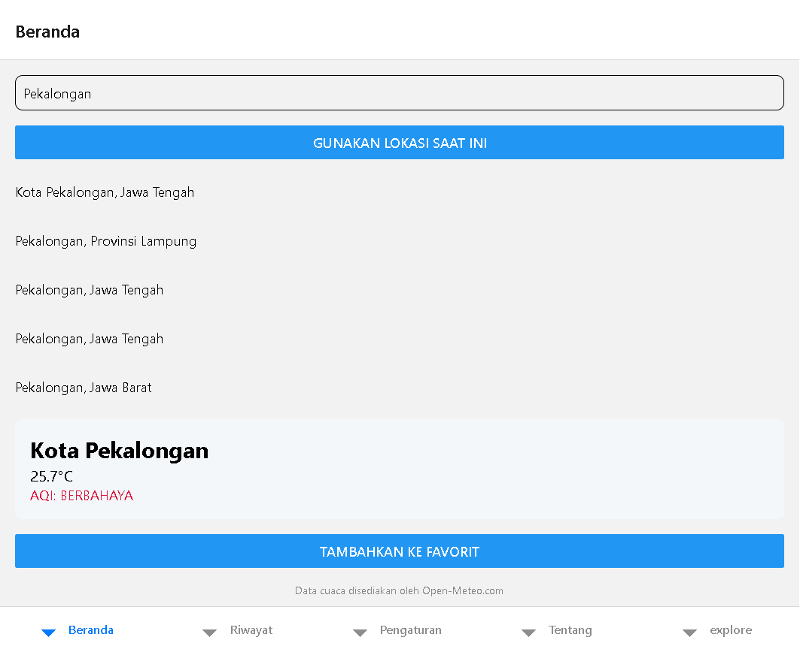
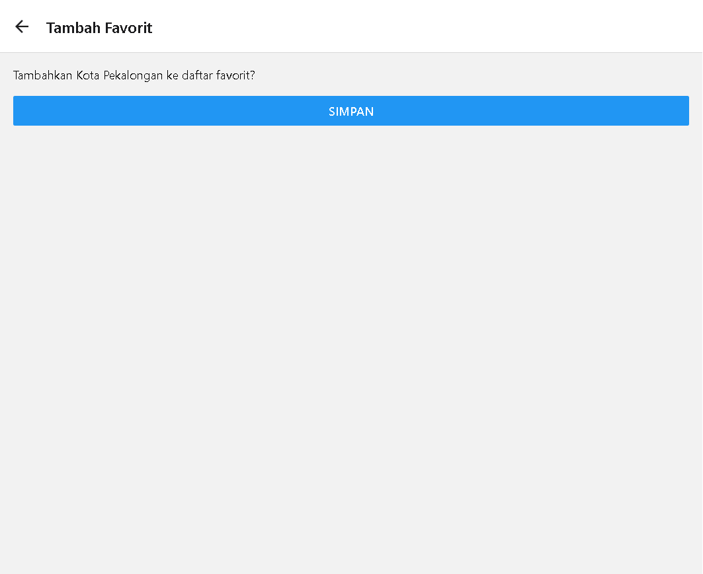
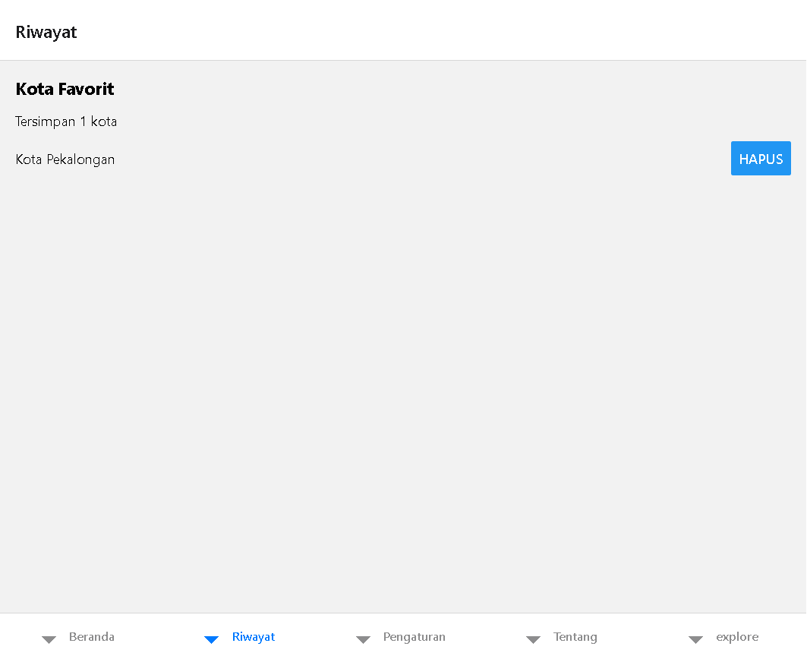
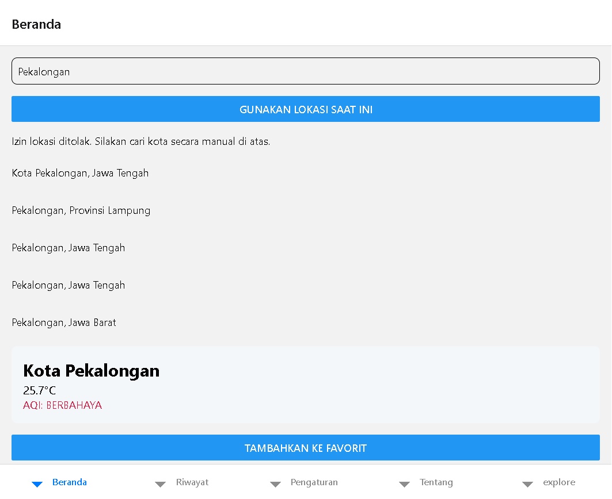

# Laporan Praktikum Pertemuan 6

## Lokasi, Permission, dan Penyimpanan Favorit

**Nama proyek:** Jelajah Aman  
**Platform pengujian:** Expo Web  
**Tanggal pengujian:** 11 Oktober 2026  
**Commit implementasi:** `56de3c6`

## 1. Tujuan

Praktikum ini bertujuan untuk:

1. Meminta permission lokasi dengan prinsip foreground-only.
2. Mengambil koordinat lokasi perangkat.
3. Menyediakan fallback pencarian manual ketika lokasi ditolak atau tidak tersedia.
4. Menyimpan kota favorit secara persisten menggunakan AsyncStorage.
5. Menampilkan, menghitung, mencegah duplikasi, dan menghapus kota favorit.

## 2. Implementasi

### 2.1 Permission dan lokasi

Implementasi berada di [locationService.ts](./src/services/locationService.ts).

- `hasServicesEnabledAsync()` digunakan untuk membedakan layanan lokasi tidak tersedia.
- `requestForegroundPermissionsAsync()` digunakan untuk izin **When In Use**.
- Status yang ditangani: `granted`, `denied`, dan `unavailable`.
- Deskripsi permission berada di [app.json](./app.json):

  > Jelajah Aman menggunakan lokasi Anda untuk menampilkan cuaca di kota terdekat.

Beranda pada [index.tsx](./src/app/(tabs)/index.tsx) menampilkan pesan yang jelas dan tetap menyediakan pencarian kota manual.

### 2.2 Penyimpanan favorit

Implementasi berada di [favoritStorage.ts](./src/services/favoritStorage.ts).

- `ambilSemuaFavorit()` membaca data dari AsyncStorage.
- `tambahFavorit()` menyimpan data kota dan mencegah duplikasi berdasarkan `id`.
- `hapusFavorit()` menghapus kota berdasarkan `id`.
- Data disimpan sebagai JSON dengan key `@jelajah_aman:favorit`.

Tipe datanya berada di [favorit.ts](./types/favorit.ts):

```ts
interface KotaFavorit {
  id: number;
  nama: string;
  latitude: number;
  longitude: number;
}
```

### 2.3 Alur tambah favorit

Alur Beranda pada [index.tsx](./src/app/(tabs)/index.tsx) mengirim parameter string melalui Expo Router ke modal:

```ts
router.push({
  pathname: "/tambah-favorit",
  params: {
    id: String(kotaTerpilih.id),
    nama: kotaTerpilih.name,
    lat: String(kotaTerpilih.latitude),
    lon: String(kotaTerpilih.longitude),
  },
});
```

Modal pada [tambah-favorit.tsx](./src/app/tambah-favorit.tsx) mengubah parameter kembali menjadi angka, memvalidasi data, menyimpan ke AsyncStorage, dan kembali ke halaman sebelumnya.

### 2.4 Riwayat dan penghapusan

Implementasi berada di [riwayat.tsx](./src/app/(tabs)/riwayat.tsx).

- `useFocusEffect` memuat ulang data setiap tab Riwayat aktif.
- Jumlah favorit ditampilkan sebagai `Tersimpan X kota`.
- Tombol Hapus menghapus data dari AsyncStorage dan langsung memperbarui tampilan.
- Native menggunakan `Alert.alert` dengan tombol Batal dan Hapus.
- Web menggunakan `confirm()` karena perilaku `Alert.alert` tidak sama pada React Native Web.

## 3. Hasil pengujian

| No. | Skenario | Hasil |
|---:|---|---|
| 1 | Beranda dapat dibuka | Berhasil |
| 2 | Pencarian kota manual | Berhasil |
| 3 | Data cuaca dan AQI tampil setelah memilih kota | Berhasil |
| 4 | Atribusi Open-Meteo tampil | Berhasil |
| 5 | Permission lokasi ditolak | Berhasil, pesan penolakan tampil dan pencarian manual tetap tersedia |
| 6 | Modal tambah favorit terbuka | Berhasil |
| 7 | Kota favorit tersimpan | Berhasil |
| 8 | Jumlah favorit tampil | Berhasil |
| 9 | Favorit tampil di Tab Riwayat | Berhasil |
| 10 | Pencegahan duplikasi favorit | Diimplementasikan melalui pengecekan `id` |
| 11 | Konfirmasi hapus | Berhasil pada web melalui `confirm()`; native menggunakan `Alert.alert` |
| 12 | Favorit hilang setelah penghapusan | Berhasil |
| 13 | TypeScript check | Berhasil |
| 14 | Web export/build | Berhasil |

## 4. Dokumentasi screenshot

### 4.1 Beranda

Halaman awal menampilkan SearchBox, tombol lokasi, atribusi Open-Meteo, dan navigasi tab.



### 4.2 Pencarian kota, cuaca, dan AQI

Setelah memilih Kota Pekalongan, aplikasi menampilkan WeatherCard, suhu, AQI, dan tombol tambah favorit.



### 4.3 Modal tambah favorit

Modal menerima nama kota dan menyediakan tombol Simpan.



### 4.4 Tab Riwayat

Setelah disimpan, kota tampil dalam daftar favorit dan jumlahnya terlihat pada teks `Tersimpan 1 kota`.



### 4.5 Permission ditolak dan fallback manual

Pada pengujian web, permission lokasi ditolak. Aplikasi menampilkan pesan penolakan dan tetap mempertahankan pencarian manual.



## 5. Validasi teknis

Perintah berikut berhasil dijalankan:

```text
npx tsc --noEmit
Exit code: 0

npx expo export --platform web
Exit code: 0
```

Remote GitHub juga sudah diperbarui:

```text
main -> origin/main
```

## 6. Catatan pengujian perangkat

Screenshot pada laporan ini berasal dari pengujian Expo Web. Pengujian `granted` dan `unavailable` secara penuh sebaiknya dilakukan pada perangkat fisik atau emulator yang mendukung simulasi GPS, sesuai arahan modul:

- **Granted:** izinkan permission lokasi dan pastikan cuaca lokasi saat ini tampil.
- **Denied:** tolak permission dan pastikan fallback pencarian manual tetap dapat digunakan.
- **Unavailable:** matikan layanan lokasi dan pastikan aplikasi tidak crash serta menampilkan pesan layanan tidak aktif.

## 7. Kesimpulan

Fitur Pertemuan 6 telah diimplementasikan pada proyek Jelajah Aman, meliputi permission lokasi foreground, fallback pencarian manual, AsyncStorage, modal tambah favorit, daftar Riwayat, jumlah favorit, pencegahan duplikasi, konfirmasi hapus, dan kompatibilitas web.

