# Laporan Ujian Tengah Semester (UTS)

## Pengembangan & Penyempurnaan Aplikasi "Jelajah Aman"

**Nama Mahasiswa:** Ahmad Turmudi  
**NIM:** 60324069  
**Mata Kuliah:** Pemrograman Berbasis Platform (INF2528 - 4 SKS)  
**Program Studi:** S1 Informatika, Fakultas Sains dan Teknologi  
**Institusi:** UIN K.H. Abdurrahman Wahid Pekalongan  
**Dosen Pengampu:** Reza Iqbal Pramudya, M.Kom  
**Pertemuan / Bobot:** Pertemuan 8 (UTS) — 25% dari nilai akhir  
**Tanggal Pengujian:** 26 Oktober 2026  
**Tautan Repositori GitHub:** `https://github.com/AHTURRR/orientasi-jelajah-aman2`

---

## 1. Ringkasan Fitur UTS yang Diimplementasikan

Keempat fitur penyempurnaan wajib UTS telah diimplementasikan secara lengkap pada aplikasi **Jelajah Aman** dengan tetap mempertahankan seluruh fitur dari Pertemuan 1–7:

1. **Kustomisasi Ikon Tab Bar & Perbaikan Label Navigasi (`@expo/vector-icons`):**
   - Mengganti ikon bawaan pada Expo Router Tabs di [`src/app/(tabs)/_layout.tsx`](./src/app/(tabs)/_layout.tsx) menggunakan paket `@expo/vector-icons` (`Ionicons`).
   - Setiap tab memiliki ikon representatif yang unik dan berubah saat aktif (*focused*):
     - **Beranda:** `partly-sunny` / `partly-sunny-outline`
     - **Riwayat & Favorit:** `bookmarks` / `bookmarks-outline`
     - **Pengaturan:** `settings` / `settings-outline`
     - **Tentang:** `information-circle` / `information-circle-outline`
   - Merapikan label tab kedua menjadi **"Riwayat & Favorit"** agar fungsi peninjauan riwayat pencarian terakhir, cache offline kota, dan kota favorit lebih intuitif.

2. **Fitur Riwayat Pencarian Terakhir (*Recent Search History*):**
   - Mengimplementasikan layanan penyimpanan lokal [`src/services/riwayatStorage.ts`](./src/services/riwayatStorage.ts) menggunakan `AsyncStorage` (`@jelajah_aman:riwayat_pencarian`).
   - Menyimpan otomatis maksimal **10 pencarian kota terakhir** (`MAKS_RIWAYAT = 10`) dengan pencarian terbaru di urutan paling atas dan mencegah duplikasi kota yang sama.
   - Ketika salah satu item riwayat di tab **Riwayat & Favorit** diklik, aplikasi otomatis berpindah ke **Beranda** dan langsung menampilkan cuaca kota tersebut.

3. **Cache Kota (Mode Offline) & Penghapusan Cache per Kota dengan Konfirmasi:**
   - Menyimpan data cuaca dan suhu terakhir kota ke penyimpanan lokal saat online serta menampilkannya kembali saat offline.
   - Menambahkan tombol **"Hapus Cache"** pada setiap item kota di daftar kota tersimpan (baik di Beranda maupun di tab Riwayat & Favorit).
   - Menampilkan dialog konfirmasi sebelum penghapusan (`Alert.alert` di Mobile/Expo Go dan `globalThis.confirm` di Browser Web), lalu menghapus cache kota terkait dan memperbarui tampilan.

4. **Implementasi Tema Gelap / Terang (*Dark / Light / System Mode*):**
   - Membangun `ThemeProvider` ([`src/context/ThemeContext.tsx`](./src/context/ThemeContext.tsx)) dengan tiga pilihan di menu **Pengaturan**: **Terang**, **Gelap**, dan **Ikuti Sistem**.
   - Menyimpan preferensi tema secara persisten di `AsyncStorage` (`@jelajah_aman:preferensi_tema`) dan menerapkannya secara dinamis ke seluruh layar (**Beranda**, **Riwayat & Favorit**, **Pengaturan**, **Tentang**, **Modal**, dan **Detail**).

---

## 2. Hasil Pengujian Browser End-to-End (E2E)

| No. | Fitur & Skenario Uji | Hasil yang Diharapkan | Hasil Aktual (Browser E2E) | Status |
| :---: | :--- | :--- | :--- | :---: |
| 1 | **Ikon & Label Navigasi** | 4 tab menampilkan ikon `Ionicons` unik & label `"Riwayat & Favorit"` jelas | Terverifikasi tampil di bilah navigasi bawah pada seluruh layar | **LULUS** |
| 2 | **Batas Maksimal 10 Riwayat Pencarian** | Pencarian 12 kota berbeda hanya menyimpan 10 kota terakhir, terbaru di atas | Tampil teks `"Menampilkan 10 dari maksimal 10 pencarian kota terakhir"` dengan urutan terbaru di atas | **LULUS** |
| 3 | **Klik Item Riwayat Pencarian** | Klik kota `"Medan"` di tab Riwayat otomatis membuka cuaca Medan di Beranda | Beranda langsung terbuka dan menampilkan cuaca serta suhu Kota Medan | **LULUS** |
| 4 | **Konfirmasi Hapus Cache (Batal & Setuju)** | Muncul dialog konfirmasi; Batal mempertahankan cache, Setuju menghapus cache kota terkait | Dialog konfirmasi tampil; saat Batal cache tetap ada, saat Setuju cache Medan terhapus sementara 9 kota lain tetap utuh | **LULUS** |
| 5 | **Mode Offline (Cache Tersedia vs Tanpa Cache)** | Kota ber-cache tampil dengan badge oranye; kota tanpa cache tampil pesan error + tombol Coba Lagi | Kota Makassar tampil dari cache (`31.5°C`) dengan badge oranye; kota Medan (yang cache-nya telah dihapus) menampilkan pesan error offline dengan tombol Coba Lagi | **LULUS** |
| 6 | **Tema Aplikasi (Terang, Gelap, Ikuti Sistem)** | Perubahan tema diterapkan dinamis ke seluruh layar & bertahan setelah reload | Beranda, Riwayat & Favorit, Pengaturan, dan Tentang berubah ke tema Gelap/Terang secara konsisten dan bertahan setelah `reload()` | **LULUS** |

---

## 3. Dokumentasi Tangkapan Layar Hasil Pengujian Browser

### 3.1 Beranda & Kustomisasi Ikon Tab Bar (`@expo/vector-icons`)
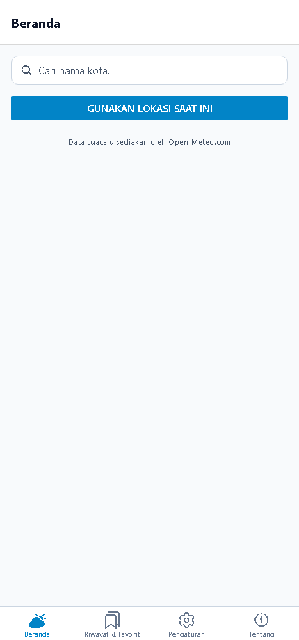

### 3.2 Pencarian Cuaca Kota & Penyimpanan Cache Suhu
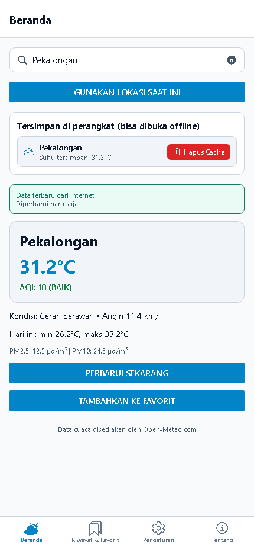

### 3.3 Tab Riwayat & Favorit (Batas Maksimal 10 Pencarian Terakhir)
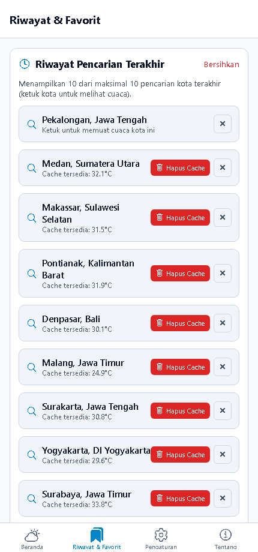

### 3.4 Klik Item Riwayat Otomatis Menampilkan Cuaca Kota di Beranda
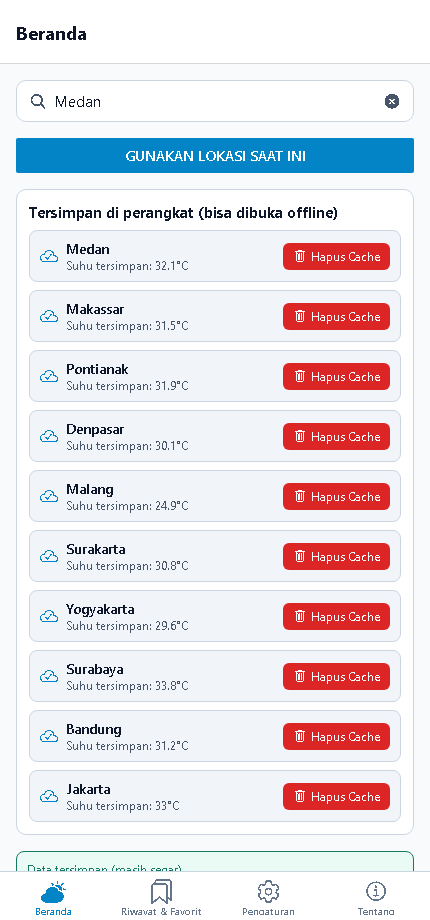

### 3.5 Daftar Cache Setelah Penghapusan Cache Kota "Medan" Dikonfirmasi
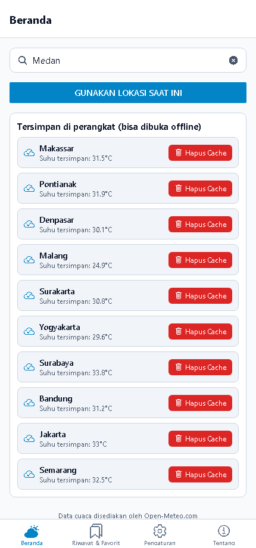

### 3.6 Mode Offline: Menampilkan Data dari Cache vs Kondisi Tanpa Cache
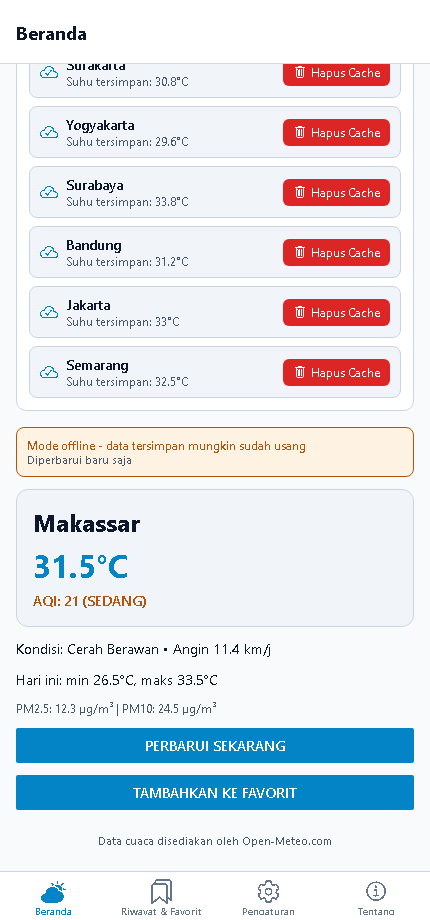

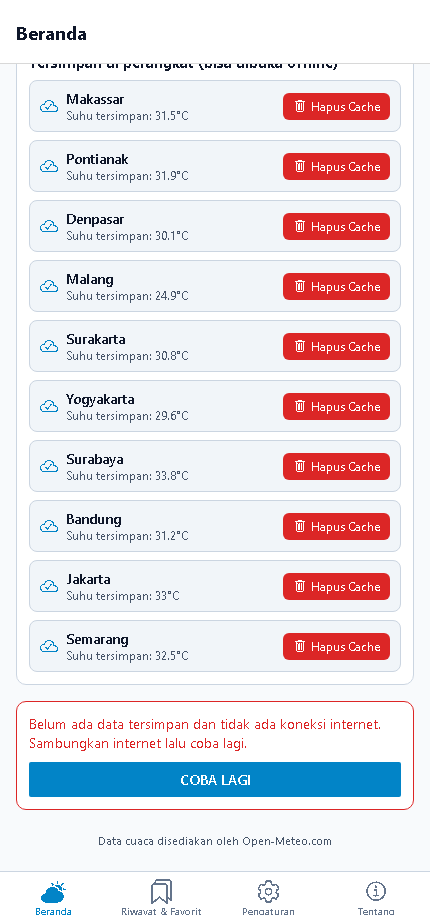

### 3.7 Pengaturan Tema Terang, Gelap, & Ikuti Sistem beserta Penerapan di Seluruh Layar
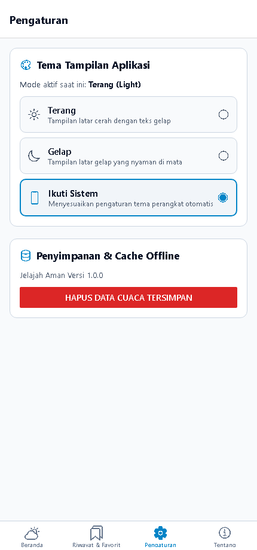

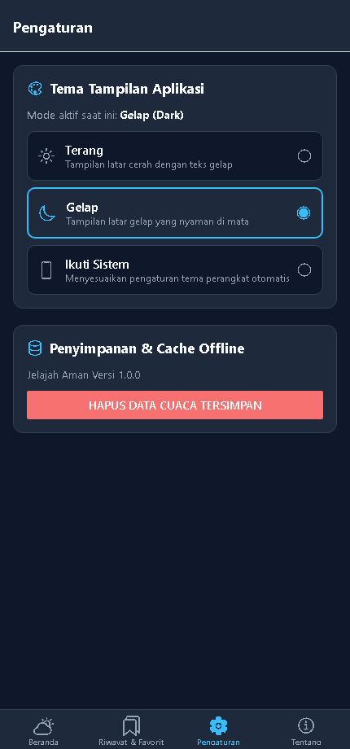

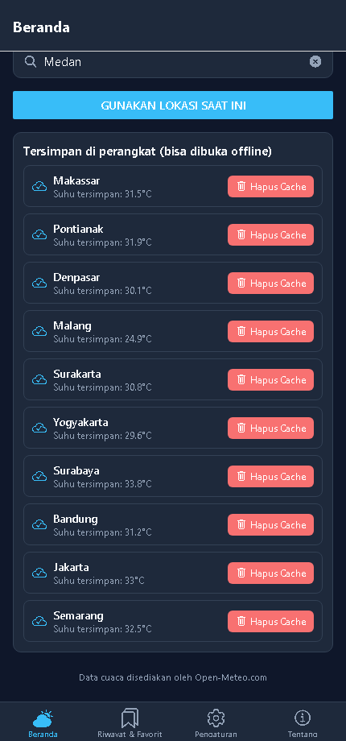

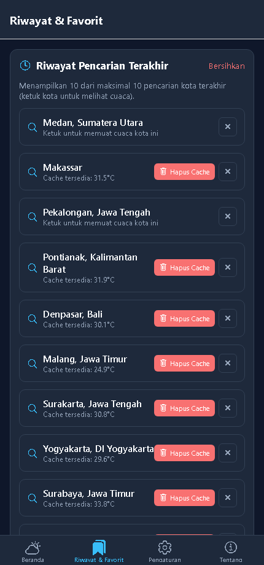

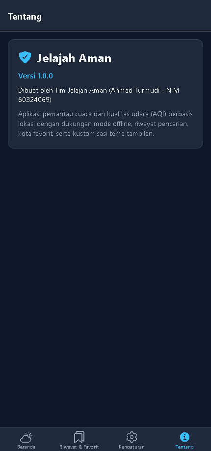
